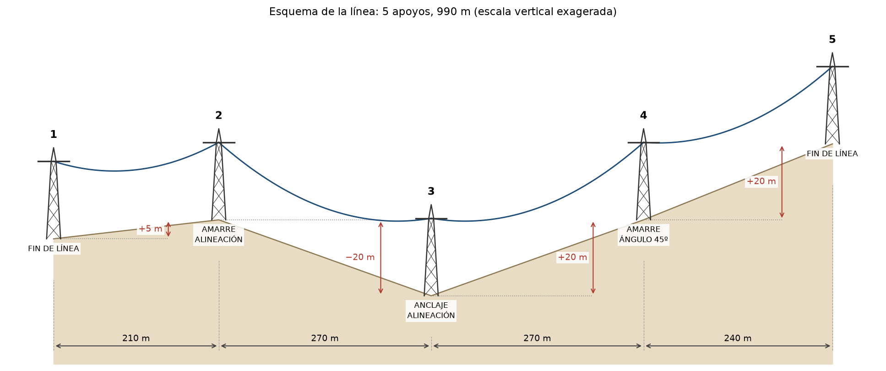

# Cálculo mecánico de apoyos

Explicación de lo que hace la clase `CalculoApoyos` (y `Armado`) de [`alta_tension.py`](../alta_tension.py), según el Tema 9 y la ITC-LAT-07 (apartado 3.5.3).

## Índice

1. [Objetivo](#1-objetivo)
2. [Cómo se describe la línea](#2-cómo-se-describe-la-línea)
3. [Cantones y tensiones de cada vano](#3-cantones-y-tensiones-de-cada-vano)
4. [Gravivano y eolovano](#4-gravivano-y-eolovano)
5. [Armados: cruceta y cadenas](#5-armados-cruceta-y-cadenas)
6. [Hipótesis de cálculo](#6-hipótesis-de-cálculo)
7. [Tabla de esfuerzos para elegir el apoyo](#7-tabla-de-esfuerzos-para-elegir-el-apoyo)
8. [Esquema de la línea](#8-esquema-de-la-línea)
9. [Correspondencia con el código](#9-correspondencia-con-el-código)
10. [Validación](#10-validación)
11. [Limitaciones](#11-limitaciones)

## 1. Objetivo

Calcular los esfuerzos que transmiten los conductores a cada apoyo en las cuatro hipótesis del reglamento, y juntarlos en una tabla preparada para buscar el apoyo en las tablas del fabricante.

## 2. Cómo se describe la línea

La línea se describe apoyo a apoyo, numerándolos desde 1:

| Dato | Qué es | Ejemplo (5 apoyos) |
|---|---|---|
| `vanos` | Vano entre cada par de apoyos consecutivos [m] (n − 1 valores) | `[210, 270, 270, 240]` |
| `desniveles` | Altura de cada apoyo **respecto al anterior** [m] (n valores, el 1º siempre 0) | `[0, 5, -20, 20, 20]` |
| `tipos` | Tipo de cada apoyo | `["fin de línea", "amarre", "anclaje", "amarre", "fin de línea"]` |
| `angulos` | Ángulo de los apoyos de ángulo, por **número de apoyo** [º] | `{4: 45}` |

Tipos admitidos (`TIPOS_APOYO`): principio de línea, fin de línea, suspensión, amarre y anclaje, escritos con o sin tildes y mayúsculas. Los de suspensión, amarre y anclaje son de **alineación** salvo que tengan ángulo; los de principio y fin de línea no pueden tener ángulo.

## 3. Cantones y tensiones de cada vano

Un **cantón** es el tramo entre dos apoyos con cadenas de amarre: la línea se corta en todos los apoyos que **no son de suspensión**. Dentro de un cantón las cadenas de suspensión se mueven y todos los vanos quedan con la misma tensión horizontal, así que el cantón se calcula como un solo vano, el **vano de regulación**:

$$a_r = \sqrt{\frac{\sum a_i^3}{\sum a_i}}$$

Cada cantón tiene su propio `calculoMecanico`, con su vano de regulación y su **mayor desnivel**. La tensión de cada vano en cada hipótesis es la de su cantón (T₀, o $T_m$ si hay desnivel).

Si el **enunciado da las tensiones**, se pasan en un `DataFrame` con los tramos como filas (`"2-3"`, `"3-4"`…) y las hipótesis como columnas (`"hielo"`, `"viento"`…), y se usan en lugar de las calculadas. Los tramos que no se den quedan vacíos, y si una hipótesis los necesita, el error dice cuál falta.

## 4. Gravivano y eolovano

**Eolovano**: longitud de conductor cuyo **viento** soporta el apoyo. Es la mitad de cada vano contiguo:

$$a_e = \sum \frac{a}{2}$$

**Gravivano**: longitud de conductor cuyo **peso** soporta el apoyo, es decir, la distancia entre los puntos más bajos de los vanos contiguos. Con desnivel, el apoyo más alto carga con más peso:

$$a_g = \sum \left[\frac{a}{2} \pm \frac{T}{p}\cdot\frac{d}{a}\right]$$

- *T* es la tensión del vano y *p* el peso aparente de la hipótesis (con viento o con hielo).
- *d* es el desnivel del vano. El signo es **+** en el vano anterior (si este apoyo está más alto que el anterior, carga más) y **−** en el siguiente (si el siguiente está más alto, este carga menos).

## 5. Armados: cruceta y cadenas

Lo que lleva montado cada apoyo se describe con un **`Armado`**:

| Dato | Qué es |
|---|---|
| `peso_cruceta` | Peso de la cruceta [daN] |
| `peso_cadena` | Peso de **una** cadena de aisladores con sus herrajes [daN] |
| `brazo` | Distancia del conductor exterior al eje del apoyo [m] (solo para la 4ª hipótesis) |
| `forma` | Forma del apoyo: `"celosía"` (por defecto) o `"chapa"` |
| `b`, `c` | Cotas de la cruceta de bóveda [m], para el factor de chapa |
| `hc`, `h0` | Datos del fabricante para el factor de chapa (5 m y 0,25 m por defecto) |

Se pasa uno para todos los apoyos (`armados=armado`) o uno por tipo de apoyo (`armados={"suspensión": ..., "resto": ...}`); la clave `"resto"` vale para los tipos que no se pongan.

El peso que añade el armado al apoyo es

$$P_{armado} = n \cdot c \cdot P_{cadena} + P_{cruceta}$$

con *n* el número de conductores (3 en un circuito simple) y *c* las cadenas por fase, que pone la librería según el tipo (`CADENAS_POR_FASE`):

| Tipo | Cadenas por fase |
|---|---|
| Suspensión, principio y fin de línea | 1 |
| Amarre y anclaje | 2 (una a cada lado) |

## 6. Hipótesis de cálculo

Cada hipótesis da los esfuerzos del apoyo: **V** vertical, **T** transversal, **L** longitudinal [daN] y **Mt** momento torsor [daN·m]. Notación: *n* conductores, *α* ángulo del apoyo, $T_i$ la tensión de cada vano contiguo, $p_v$ la sobrecarga de viento (sin el peso propio), $p$ el peso propio y $p_h$ el peso con hielo.

### 6.1 Primera: viento

Viento de 120 km/h (140 en categoría especial) a la temperatura de la hipótesis de viento de la zona.

| Esfuerzo | Alineación | Ángulo |
|---|---|---|
| V | $n\,p\,a_g + P_{armado}$ | igual |
| T | $n\,p_v\,a_e$ | $n\left[\sum T_i \sin\frac{\alpha}{2} + p_v\,a_e\cos\frac{\alpha}{2}\right]$ |
| L | solo en principio y fin de línea: $n\,T$ | — |

### 6.2 Segunda: hielo (zonas B y C)

| Esfuerzo | Alineación | Ángulo |
|---|---|---|
| V | $n\,p_h\,a_g + P_{armado}$ | igual |
| T | — | $n\sum T_i \sin\frac{\alpha}{2}$ |
| L | solo en principio y fin de línea: $n\,T$ | — |

En categoría especial (hielo + viento) todavía no está implementada.

### 6.3 Tercera: desequilibrio de tracciones

No se aplica en principio y fin de línea, porque ahí el 100 % de la tracción ya está en la 1ª y la 2ª. Se calcula con la sobrecarga de **hielo** en las zonas B y C y con la de **viento** en la zona A. Por un lado del apoyo tira $T_{max}$ (la mayor tensión de los dos vanos) y por el otro $(1-k)\,T_{max}$:

| Esfuerzo | Alineación | Ángulo |
|---|---|---|
| V | la de la 2ª (o la 1ª en zona A) | igual |
| T | — | $n\,(2-k)\,T_{max}\sin\frac{\alpha}{2}$ |
| L | $n\,k\,T_{max}$ | $n\,k\,T_{max}\cos\frac{\alpha}{2}$ |

Desequilibrio *k* (`DESEQUILIBRIO`):

| Tipo | Un ≤ 66 kV | Un > 66 kV |
|---|---|---|
| Suspensión | 8 % | 15 % |
| Amarre | 15 % | 25 % |
| Anclaje | 50 % | 50 % |

### 6.4 Cuarta: rotura de conductores

Se rompe el conductor exterior del vano con más tensión, lo que produce un **momento torsor**:

$$M_t = R \cdot T \cdot brazo$$

con *R* = 50 % en suspensión y 100 % en el resto (`ROTURA`). El peso vertical es el de las fases sanas más la mitad del vano de la fase rota (nada en fin de línea), como en los ejemplos de clase:

$$V = (n-1)\,p\,a_g + p\,\frac{a_{roto}}{2} + P_{armado}$$

**Cuándo se calcula** (`hipotesis_aplicables`): por defecto (`rotura=None`), se **omite** en suspensión y amarre si se cumplen a la vez:

- Un ≤ 66 kV,
- carga de rotura del conductor menor de 6600 daN,
- coeficiente de seguridad de al menos 3.

Con `rotura=True` o `rotura=False` se fuerza.

## 7. Tabla de esfuerzos para elegir el apoyo

`esfuerzos(numero)` junta las hipótesis que se aplican en una tabla (filas V, T, L y Mt; columnas 1ª a 4ª), como en los resúmenes de clase. Antes, adapta T y L a lo que dan las tablas del fabricante según la forma del apoyo:

- **Celosía** (UNE 207017): cuando hay T y L a la vez, se suman en un único esfuerzo horizontal, que se da como L.
- **Chapa** (UNE 207018): el fabricante da los esfuerzos a una altura $h_0$ por debajo de la cogolla, así que T y L se multiplican por el factor

$$f = \frac{h + h_c}{h_c - h_0}, \qquad h = \frac{b + 2c}{3}$$

donde *h* es la altura de la resultante de los tres conductores en una cruceta de bóveda de cotas *b* y *c*. El `Armado` lo calcula solo si tiene `b` y `c` (`armado.factor_chapa`); si no, vale 1.

Las hipótesis sueltas (`hipotesis_viento(numero)`, etc.) devuelven los esfuerzos **sin** esta adaptación.

## 8. Esquema de la línea

`esquema()` dibuja el perfil de la línea: el terreno, los apoyos con su número y su tipo, los vanos, los desniveles y el conductor de cada vano con la parábola de la hipótesis de temperatura máxima de su cantón (con la escala vertical exagerada).

Por defecto **lo guarda** en `esquemas/esquema_apoyos.png` (crea la carpeta si no existe) y **lo muestra** en pantalla. Con `nombre=` y `carpeta=` se cambia dónde se guarda, y con `guardar=False` o `mostrar=False` se evita cada cosa (con `mostrar=False` devuelve la figura).

## 9. Correspondencia con el código

| Método | Qué hace |
|---|---|
| `Armado.factor_chapa` | Factor de chapa del apartado 7 |
| `CalculoApoyos._cantones`, `cantones`, `calculo_vano` | Cantones y su cálculo mecánico (apartado 3) |
| `tensiones`, `tensiones_calculadas` | Tensión de cada vano en cada hipótesis, y si es calculada o del enunciado |
| `gravivano`, `eolovano` | Apartado 4 |
| `armado(numero)`, `formas` | Armado y forma de cada apoyo (apartado 5) |
| `hipotesis_viento`, `hipotesis_hielo`, `hipotesis_desequilibrio`, `hipotesis_rotura` | Las cuatro hipótesis (apartado 6) |
| `hipotesis_aplicables` | Qué hipótesis se calculan en cada apoyo |
| `esfuerzos` | Tabla para elegir el apoyo (apartado 7) |
| `esquema` | Dibujo del perfil (apartado 8) |
| `funcion`, `etiqueta` | Alineación o ángulo, y texto del apoyo en el esquema |

## 10. Validación

- **Ejemplo SJR005** (*«Cálculo mecánico de apoyos de una línea aérea de 3ª categoría»*: LA-110, 1200 m, 7 apoyos con suspensiones de chapa y bóveda):
  - las tensiones de sus tres cantones, con diferencias menores del 1 %;
  - 39 esfuerzos de las cuatro hipótesis, con diferencias menores del 0,5 % (el PDF redondea el peso del conductor);
  - los 7 resúmenes de esfuerzos, con los mismos huecos (hipótesis que no aplican) que el PDF.
- **Ejercicio de evaluación continua** (LA-180 cruzando un valle): sirve para probar las tensiones dadas por el enunciado, qué hipótesis se aplican en cada apoyo (la 4ª se omite en el amarre pero no en el anclaje) y el esquema.

Están en `tests/test_apoyos.py`.

## 11. Limitaciones

- La 2ª hipótesis de categoría especial (hielo + viento) no está implementada.
- En la 4ª hipótesis, la fase rota sostiene la mitad de su vano, como en los ejemplos de clase (pendiente de confirmar con el profesor).
- No se elige el apoyo automáticamente: la tabla de esfuerzos se compara a mano con las del fabricante.
- Los cantones y las tensiones se calculan al crear el objeto: si se cambian los datos después, hay que crear otro `CalculoApoyos`.
